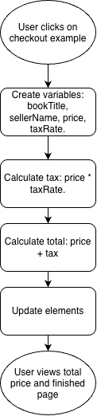

# Script Idea
The script idea is to create a checkout page for the example listing using Javascript and also adding an artithmetic factor calculating the total price. The script will be on the "How to Sell Your Book" webpage. It enables user interaction by allowing them to see what buying the textbook would look like. It provides a feature to see how checking out looks like.

# Goals
I want the script to benefit the user by showing an example of a checkout page. It will enhance user experience and provide valuable calculations by showing the total price of the book attributing for the original price along with the tax.

# Task Breakdown
1. Create variables for the book title and seller
2. Create variables for the price and tax rate
3. Calculate the tax: price * taxRate
4. Calculate the total: price + tax
5. Find each HTML element by their IDs
6. Update each element’s text with the results

# Flowchart

