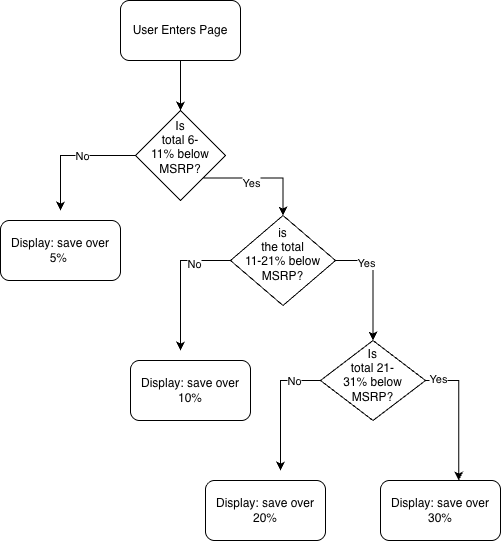

## Decision Tree:

I will implement a decision tree that changes what text is displayed depending on how good of a deal the price of a listing is compared to its MSRP price.

The script compares the listing's total (price + tax) to the MSRP. Each node checks whether the total falls in a certain discount range using the AND operator to make sure it is below one limit and above another.

### Node 1: Is the total 6-11% below the MSRP?
- **Yes:** Display "You'll save over 5% off the MSRP price!"
- **No:** Go to Node 2.

### Node 2: Is the total 11-21% below the MSRP?
**Yes:** Display "You'll save over 10% off the MSRP price!"
**No:** Go to Node 3.

### Node 3: Is the total 21-31% below the MSRP?
- **Yes:** Display "You'll save over 20% off the MSRP price!"
- **No:** Go to the else branch.

### Else: The total is more than 31% below the MSRP
- Display "You'll save over 30% off the MSRP price!"

Each branch is leading to the last branch because it checks how big of a discount the user is getting, with the final decision being to display to the user they're saving over 30%.

## Flowchart:

