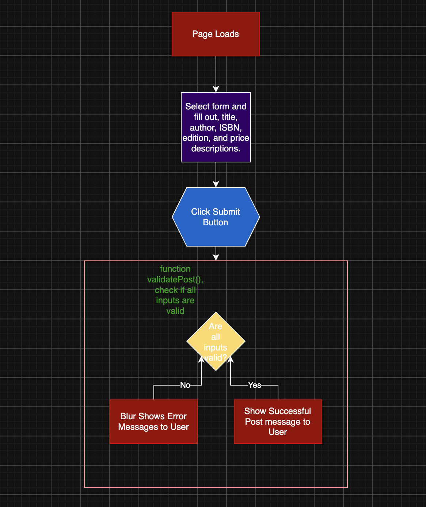

# A. Describe Your Event

When a user fills out the "Try Posting a Textbook" form, each of the input fields will have focus and blur states. On focus, the form will show a message like "Cannot be blank" to the user. On blur, a function will be called that checks the input and shows an error message if it is not long enough or has an invalid input like putting a string for the price. When the user clicks the submit button, it notifies the user it was successfully submitted.

# B. Draw an Event Handling Flowchart

